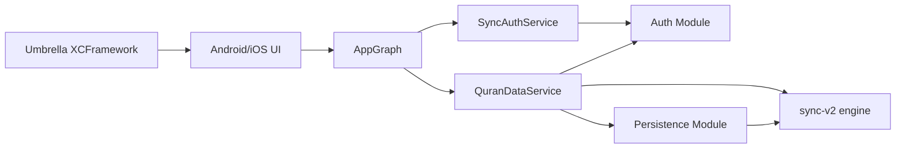

# mobile-sync

Kotlin Multiplatform sync/data stack for Quran mobile apps.

This repository contains shared modules used by Android and iOS apps for:
- Authentication (OIDC)
- Local persistence (SQLDelight)
- Sync engine orchestration
- A unified managed data API (`QuranDataService`)

## Table of Contents
- [Architecture](#architecture)
- [Modules](#modules)
- [Requirements](#requirements)
- [Quick Start](#quick-start)
- [Usage](#usage)
- [Run the Demos](#run-the-demos)
- [Build, Test, and Release Commands](#build-test-and-release-commands)
- [Related Repositories](#related-repositories)

## Architecture

`auth` + `persistence` + `sync-v2` are composed in `sync-pipelines`, exposed through a managed DI graph (`AppGraph` / `SharedDependencyGraph`), and exported to iOS through `umbrella`. The repositories write plain domain tables (no sync columns); the sync engine diffs them against the last state both sides agreed on (`sync_item`) to find what to push.



### Sync

- **Engine (`:sync-v2`).** Each run fetches every change since the stored token, merges it three ways with the local changes (an edit beats a delete), and pushes what is left in batches of at most 100. An item the server keeps refusing is held, so the rest still syncs. [SYNC_ENGINE.md](SYNC_ENGINE.md) maps how.
- **Persistence on plain tables.** The repositories write plain domain tables, owned by `:sync-v2`'s types, through one store per type, so the app and the importer follow the same rules. The tables carry no sync columns; the engine keeps its own state in `sync_item` and `sync_meta`.
- **Wiring (`:sync-pipelines`).** `SyncClient` runs the engine for the signed-in account and reports each run; `SyncScheduler` decides when runs happen.
- **When it syncs.** A run starts 30 seconds after app start (at once when the saved session is restored), 5 seconds after a local change, and at once for `triggerSync(immediately = true)` and a sign-in. A token refresh starts no run. After every run, success or not, the next one is due in 30 minutes, so sync never stops. Runs never overlap. A failed run is retried with exponential backoff (200 ms, ×2.5, up to 5 retries). A 403 that may be the token's scope pauses pushes for a while; automatic runs keep pulling.
- **Auth.** The sync account is the ID token's `sub`. Signing in to a different account wipes the previous account's local data before anything is pushed. A 401 forces one token refresh and runs again; a refused refresh ends the session, while a network error, a timeout or a server error during a refresh keeps it.
- **Status.** `QuranDataService.syncStatus` shows `Idle`, `Syncing`, or how the latest run ended: `Succeeded` with its time, or `Failed` with its time and a `SyncError`.

## Modules

| Module | Purpose |
|---|---|
| `:auth` | OIDC login/logout, auth state, token handling |
| `:persistence` | The app database (`MobileSyncDatabase`) and the repositories for bookmarks/collections/notes/reading sessions, over `:sync-v2`'s plain tables |
| `:sync-v2` | The generic sync engine (fetch, three-way merge, push) and the plain domain tables of its types; see [SYNC_ENGINE.md](SYNC_ENGINE.md) |
| `:sync-pipelines` | DI graph, the sync client and scheduler, and the `QuranDataService` managed data API |
| `:umbrella` | iOS XCFramework export (`Shared.xcframework`) |
| `:demo:android` | Android sample app (Compose) |
| `:demo:common` | Shared demo helpers/models |
| `:mutations-definitions` | Shared helpers: the server's text rules (`ServerText`) and the DI scope (`AppScope`) |
| `:logging` | Routes logs, including HTTP calls, to a host app's logger (`MobileSyncLogging`) |

## Requirements

- JDK 17
- Android Studio (for Android demo)
- Xcode (for iOS demo)
- Cocoa toolchain for iOS simulator/device builds

Optional but recommended:
- `local.properties` with the OAuth client ID for the Android demo app:

```properties
OAUTH_CLIENT_ID=your_client_id
```

Published library artifacts do not embed credentials. Android apps are OAuth public clients using
PKCE and must not embed OAuth client secrets.

## Quick Start

1. Clone and enter the repo:
```bash
git clone https://github.com/quran/mobile-sync.git
cd mobile-sync
```

2. Ensure Gradle can resolve dependencies:
```bash
./gradlew help
```

3. Run tests:
```bash
./gradlew allTests --stacktrace --continue
```

## Usage

### Integration modes

Choose one integration mode per database.

Persistence-only mode uses the public `:persistence` repositories directly. Repositories preserve
local integrity and mutation tracking, but consumers must not mutate SQL tables directly. Use this
mode only when the database is not managed by `:sync-pipelines`.

Managed sync-capable mode uses `:sync-pipelines` through `AppGraph`. In this mode, all
user-visible data reads and writes go through `QuranDataService`, and authentication goes through
`SyncAuthService`. Do not mix direct persistence writes with the managed sync graph. If sync may be
enabled later for the same app data, use managed mode from day one, even while logged out.
Logged-out managed-service writes are local-first; sync triggers no-op until the user is
authenticated.

`AppGraph` exposes only managed facades: `quranDataService: QuranDataService` and
`authService: SyncAuthService`. Raw write-capable persistence repositories are no longer exposed
from `:sync-pipelines` `AppGraph`; they remain public in `:persistence` for persistence-only
consumers. The raw `:auth` `AuthService` is hidden from `AppGraph` and wrapped by
`SyncAuthService`.

This repository is still in active development. Schema changes are made directly in `.sq` files;
`.sqm` migrations are not currently maintained.

### 1. Initialize managed app graph (Android/Kotlin)

Configure the Android app manifest placeholders for the login and post-logout redirect URIs. The
`:auth` artifact contributes `com.quran.shared.auth.android.SafeOidcRedirectActivity` as the
exported browser callback entry point and keeps the upstream OIDC `HandleRedirectActivity`
non-exported.

```kotlin
android {
    defaultConfig {
        manifestPlaceholders["oidcRedirectScheme"] = "com.quran.oauth"
        manifestPlaceholders["oidcRedirectHost"] = "callback"
        manifestPlaceholders["oidcPostLogoutRedirectScheme"] = "com.quran.oauth"
        manifestPlaceholders["oidcPostLogoutRedirectHost"] = "callback"
    }
}
```

Do not declare or export
`org.publicvalue.multiplatform.oidc.appsupport.HandleRedirectActivity` in the app manifest.
If you override `AuthConfig.redirectUri` or `AuthConfig.postLogoutRedirectUri` on Android, keep
the corresponding manifest placeholders aligned with those URIs.

Graph construction does not require an Android `Activity`. Build the graph from application
context and runtime configuration. Optionally route Mobile Sync's logs to the app's logger with
`MobileSyncLogging.configure(sink, minSeverity)`; it must come before `SharedDependencyGraph.init`,
because HTTP clients read the severity when they are created. At `DEBUG`, HTTP calls also log their
headers and bodies, which hold user content such as note text. `configure` replaces Kermit's
process-wide logger configuration, so if the app or another library also logs with Kermit, those
logs reach the sink too. Without `configure`, logs go to the platform log, including a summary
line for each HTTP request and response.

```kotlin
import com.quran.shared.logging.MobileSyncLogSeverity
import com.quran.shared.logging.MobileSyncLogging
import com.quran.shared.persistence.DriverFactory
import com.quran.shared.pipeline.AppEnvironment
import com.quran.shared.pipeline.di.SharedDependencyGraph
import com.quran.shared.pipeline.storage.createMobileSyncStorage

// Optional.
MobileSyncLogging.configure(
    sink = { severity, tag, message -> appLog(severity, tag, message) },
    minSeverity = MobileSyncLogSeverity.INFO
)

val graph = SharedDependencyGraph.init(
    driverFactory = DriverFactory(context = applicationContext),
    storage = createMobileSyncStorage(applicationContext),
    appEnvironment = AppEnvironment.PRELIVE,
    clientId = appClientId
)

val authService = graph.authService
val quranDataService = graph.quranDataService
```

If `clientId` is blank, the same initializer creates a managed local-only graph. `QuranDataService`
continues to read and write local data, while `SyncAuthService.isAuthenticationConfigured` is
`false` and sign-in fails with an authentication-not-configured error. This lets open-source builds
run without bundled OAuth credentials.

Register the Android browser auth flow only before interactive sign-in. The registered `Activity`
handles browser launch and redirect delivery; it is not needed for graph construction or local data
operations.

```kotlin
import com.quran.shared.auth.di.AuthFlowFactoryProvider
import org.publicvalue.multiplatform.oidc.appsupport.AndroidCodeAuthFlowFactory

if (graph.authService.isAuthenticationConfigured) {
    val authFactory = AndroidCodeAuthFlowFactory(useWebView = false)
    authFactory.registerActivity(activity)
    AuthFlowFactoryProvider.initialize(authFactory)
}

// Later, from the login UI:
graph.authService.login()
```

### 2. Initialize managed app graph (iOS/Swift)

As on Android, the optional `MobileSyncLogging.configure(sink:minSeverity:)` call must come before
`SharedDependencyGraph.doInit`, because HTTP clients read the severity when they are created.

Kotlin default arguments are not exported to Swift, so pass every argument, such as
`triggerSync(immediately: false)`.

```swift
import Shared

final class AppContainer {
    static let shared = AppContainer()
    static var graph: AppGraph { shared.graph }

    let graph: AppGraph

    private init() {
        // Optional; `AppLogSink` conforms to `MobileSyncLogSink`.
        MobileSyncLogging.shared.configure(sink: AppLogSink(), minSeverity: .info)
        Shared.AuthFlowFactoryProvider.shared.doInitialize()
        let driverFactory = DriverFactory()
        let storage = AppleMobileSyncStorageFactory.shared.create()
        graph = SharedDependencyGraph.shared.doInit(
            driverFactory: driverFactory,
            storage: storage,
            appEnvironment: AppEnvironment.prelive,
            clientId: appClientId,
            clientSecret: appClientSecret
        )
    }
}
```

Advanced override for custom endpoints remains available:

```kotlin
import com.quran.shared.auth.model.AuthEnvironment
import com.quran.shared.auth.model.AuthConfig
import com.quran.shared.pipeline.SynchronizationEnvironment

val graph = SharedDependencyGraph.init(
    driverFactory = DriverFactory(context = applicationContext),
    storage = createMobileSyncStorage(applicationContext),
    environment = SynchronizationEnvironment(
        endPointURL = "https://custom-sync.example.com/auth"
    ),
    authConfig = AuthConfig(
        environment = AuthEnvironment.PRELIVE,
        clientId = appClientId
    )
)
```

### Android backup exclusions

Sync and session lifecycle metadata is stored in the shared `user_data.db` database next to the data it
describes (the sync token, account and outbox in `sync_meta`, per-item sync state in `sync_item`). Auth metadata and OAuth tokens stay outside the database, so a lost or recreated database
does not sign the user out. Both use stable DataStore file names so apps can exclude them from backup
or device transfer:

```xml
<exclude domain="file" path="datastore/quran_mobile_sync_auth.preferences_pb"/>
<exclude domain="file" path="datastore/org.publicvalue.multiplatform.oidc.tokenstore.preferences_pb"/>
```

Add those entries to both `full-backup-content` and Android 12+ `data-extraction-rules` when app
backup is enabled.

### 3. Use managed services

Core API examples:
- Observe: `authState`, `syncStatus`, `bookmarks`, `collectionsWithBookmarks`, `notes`
- Mutations: `addBookmark`, `deleteBookmark`, `addCollection`, `deleteCollection`, `addNote`, `deleteNote`
- Trigger sync: `triggerSync()` after a burst of edits, or `triggerSync(immediately = true)` for a user's "Sync now"
- Auth: use `SyncAuthService.login()`, `loginWithReauthentication()`, `logout()`, and `clearError()`

Reading bookmarks are three slots (`ReadingBookmarkSlot`), each an ayah, a page, or empty. Page
bookmarks work across mushafs: tell the library which `Mushaf` the app shows, and it does the page
mapping.

- `Mushaf.MADANI_1405` and `Mushaf.MADANI_1440`, the 1405 and 1440 Madani prints, have pages 1 to 604.
- `Mushaf.INDOPAK_15_LINES` has app pages 2 to 611: apps skip a cover page, so app page N is the
  server's page N - 1.
- `Mushaf.SHEMERLY`, the Shemerly print, has pages 1 to 521. The server has no Shemerly mushaf yet
  (quran/mobile-sync#355), so a Shemerly page is stored and synced as the 1440 page holding its
  verses (`mushafId` 1) and mapped back when read. Seven Shemerly pages (9, 364, 379, 422, 495, 500
  and 516) read back as a neighbouring page. Once the server has a Shemerly id, add it to
  `ServerMushaf` (521 pages), map it to the Shemerly layout in `PageLayout.of`, and send
  `Mushaf.SHEMERLY` as it; apps don't change.
- `Mushaf.WARSH` and `Mushaf.QALOUN`, the Warsh and Qaloun riwayat, have pages 1 to 604. They number
  verses differently, so their pages are never mapped: a page is stored with its own `mushafId` (20
  or 22), reads unchanged in the same mushaf, and reads as `EmptyReadingBookmark` in any other.
  Riwayah app builds don't sync. If one did, today's backend rejects these ids, so the change is
  held and never reaches the server; a backend that accepts them but keeps only the page group
  would relabel the page as a 1440 page until it keeps the mushaf id (quran/mobile-sync#354).
- `setPageReadingBookmark(slot, page, mushaf)` throws `IllegalArgumentException` for a page the
  mushaf doesn't have.
- A page is stored and synced with the mushaf it was set in (`mushafId`, such as 2 for
  `MADANI_1405`). Today's backend keeps only a page group and returns its stand-in mushaf (5 for
  the 604-page group, read as the 1440 layout), so after a sync a 1405 page reads as a 1440 one.
- `readingBookmarks(mushaf)`, `setPageReadingBookmark`, and `renameReadingBookmark` take the app's
  mushaf and return `PageReadingBookmark`s as pages of it. A page set in a mushaf of the same
  layout keeps its number; another becomes the page holding its middle verse. A page of a mushaf
  with no layout here (one this library doesn't know, or a riwayah such as Warsh, which numbers
  verses differently) in any other mushaf, or a page outside its mushaf's pages, reads as
  `EmptyReadingBookmark`; its location is kept, and a rename sends it back unchanged.
- Ayah bookmarks need no mapping: every Hafs mushaf numbers verses the same way, so
  `setAyahReadingBookmark` and `clearReadingBookmark` take no mushaf. An ayah bookmark is taken as a
  Hafs (sura, ayah), in riwayah builds too, which don't sync.

Import local data through `QuranDataService.importData(PersistenceImportData(...))`.
Each `ImportCollectionAyahBookmark.collectionName` must name an `ImportCollection` in the same
batch. Names match exactly, except that any case or surrounding-whitespace variant of Favorites
resolves to the default collection; entries sharing a name describe one destination.
Use `readingBookmarks` with `ImportReadingBookmark.Ayah` or `.Page`, each specifying a
`ReadingBookmarkSlot` (`TEAL`, `ORANGE`, or `RED`), `lastUpdated`, and an optional `name`; a page
also names its `Mushaf`. A page the mushaf doesn't have
is skipped with a warning; with `deleteExisting = true` its slot is cleared like an omitted slot.
Each slot may appear once. An imported slot replaces its
location, name (including clearing it when null), and modification time. Merge imports leave
omitted slots unchanged; `deleteExisting = true` clears their locations while preserving slot
identities and names for sync. Imports are atomic and report the
number of imported reading bookmarks in `PersistenceImportResult.readingBookmarksImported`.
An import writes through the repositories' rules: text is trimmed like the server, each note gets a
creation time of its own (nudged by a millisecond on a clash), a verse keeps one highlight color,
and only the newest 20 reading sessions are kept. Matching against notes already on the device and
sync linking share one note identity (`noteIdentity`): the set of verse ranges (order and repeats
ignored) and the body trimmed like the server, with each run of whitespace inside it (spaces, tabs,
newlines) counted as one space. Tracked history still matches notes by the import fingerprint, which
also ignores whitespace runs. Times don't count. An imported note equal to a note already on the
device, archived ones included, is skipped and counted in `matched`. The next sync pushes the rest
like any other local change, except that an imported note is linked, instead of pushed, to an equal
note another device synced that this device hasn't fetched yet (the same legacy notes imported on
two devices before signing in).
With `trackHistory = true`, an import records a fingerprint of each item it handled, and later tracked
imports skip those items, even after the user edits or deletes what they brought in. Logout keeps
this history, so re-running a legacy import afterwards can't bring back deleted items or add the
legacy data to another account.

Lifecycle note:
- `QuranDataService` is app-scoped. Initialize once via `SharedDependencyGraph.init(...)`.
- Prefer `SyncAuthService.logout()` for managed apps. `QuranDataService.logout()` remains available for callers that route auth and data lifecycle through one facade.
- Writes and imports don't wait for an interactive sign-in (`SyncAuthService.login()`), however long the browser stays open. A logout doesn't wait for a sign-in in progress: it ends it, so the `login()` call that opened the browser throws `CancellationException`, and another `login()` made while it ran, which waits on it, throws `AuthenticationFailedException`. A sign-in started while a logout runs fails with `SessionResetInProgressException`.
- Do not clear app-scoped services from UI/view-model teardown.

### 4. App environment selection

The published artifact can target either environment at runtime:

- `AppEnvironment.PRELIVE` / `AppEnvironment.prelive`
- `AppEnvironment.PRODUCTION` / `AppEnvironment.production`

`AppEnvironment` keeps auth and sync aligned by default:

- `PRELIVE` -> `https://prelive-oauth2.quran.foundation` and `https://apis-prelive.quran.foundation/auth`
- `PRODUCTION` -> `https://oauth2.quran.foundation` and `https://apis.quran.foundation/auth`

`buildkonfig.flavor` now only controls the default fallback used when the app does not pass an explicit app environment.

Default fallback (`gradle.properties`):

```properties
buildkonfig.flavor=debug
```

Override for release-like builds:
```bash
./gradlew :auth:build -Pbuildkonfig.flavor=release
```

## Run the Demos

### Android demo

1. Open project in Android Studio.
2. Run `demo/android` app module.

CLI build example:
```bash
./gradlew :demo:android:assembleDebug
```

### iOS demo

1. Open:
   `demo/apple/QuranSyncDemo/QuranSyncDemo.xcodeproj`
2. Select `QuranSyncDemo` scheme.
3. Run on an iOS Simulator.

The Xcode project includes a Run Script phase that calls:
```bash
./gradlew :umbrella:embedAndSignAppleFrameworkForXcode
```

CLI build example:
```bash
xcodebuild -project demo/apple/QuranSyncDemo/QuranSyncDemo.xcodeproj \
  -scheme QuranSyncDemo \
  -configuration Debug \
  -destination 'generic/platform=iOS Simulator' \
  build CODE_SIGNING_ALLOWED=NO
```

## Build, Test, and Release Commands

Build all:
```bash
./gradlew build
```

Run all tests:
```bash
./gradlew allTests --stacktrace --continue
```

Run the end-to-end sync integration tests (devices against a fake sync server; see `AGENTS.md`):
```bash
./gradlew :sync-pipelines:jvmTest --tests 'com.quran.shared.pipeline.integration.*'
```

Build iOS XCFramework:
```bash
./gradlew :umbrella:assembleSharedXCFramework
```

Build Android demo compile target:
```bash
./gradlew :demo:android:compileDebugKotlin
```

Build iOS KMP target:
```bash
./gradlew :sync-pipelines:compileKotlinIosSimulatorArm64
```

### Regenerating the page tables

Page reading bookmarks are mapped across mushafs with
`persistence/.../readingbookmark/mapping/PageLayoutTables.kt`: per-page verse ranges for the five
Hafs layouts, and each mushaf ID's page count and layout. It is generated from Quran.com's
mushaf-mapping bundle (`src/utils/mushafMapping/client_bundle.v1.json` in quran/quran.com-fe) and,
for the Shemerly layout the bundle lacks, `scripts/data/shemerly-pages.json`; never edit it by hand.
To regenerate it from a newer bundle:

1. Download the bundle at the quran.com-fe commit you want:
   ```bash
   gh api "repos/quran/quran.com-fe/contents/src/utils/mushafMapping/client_bundle.v1.json?ref=<commit>" \
     -H "Accept: application/vnd.github.raw" > /tmp/client_bundle.v1.json
   ```
2. Set `SOURCE_COMMIT` in `scripts/generate-page-layouts.py` to that commit. The file header records
   it and the bundle's revision.
3. Run the generator, which overwrites `PageLayoutTables.kt`:
   ```bash
   python3 scripts/generate-page-layouts.py /tmp/client_bundle.v1.json
   ```
   It finds each layout by its exact list of mushaf IDs (`LAYOUTS` in the script). If the bundle
   moved a mushaf between page groups, the script fails: update `LAYOUTS`.
4. Run the tests:
   ```bash
   ./gradlew :persistence:allTests
   ```
   `PageLayoutTest` checks the tables' page counts and coverage, `BundleMushafPageCountsTest` checks
   `ServerMushaf` against the bundle, and `ReadingBookmarkPageMapperTest` pins known mappings, so a
   changed layout shows up as a failing test. Mushaf IDs the bundle lacks (such as `INDOPAK`, 3)
   are mapped by hand in `PageLayout.of`.

The Shemerly layout comes from `scripts/data/shemerly-pages.json`: the `[sura, ayah]` each of its 521
pages starts with, exported from the Android app's `ShemerlyDataSource` (`suraForPageArray` and
`ayahForPageArray`; the file records the source repository, path and commit). The generator ends
each page one verse before the next starts and checks the layout like the bundle's. To update it,
replace `pageStarts` (and `source`) in that file and run the generator as above.

### Releases

The manual `Release` workflow bumps the version and tags it, attaches the iOS XCFramework to a GitHub Release, and publishes the Android/JVM artifacts to the GitHub Pages Maven repository on the `gh-pages` branch. Android apps resolve it with:
```kotlin
maven("https://quran.github.io/mobile-sync/maven") {
    content { includeGroup("com.quran") }
}
```

Maven Central releases stay manual and infrequent. Publish them from a release tag so both repositories serve the same build for a version.

Publish the GitHub Pages artifacts to a local folder to inspect them:
```bash
./gradlew publishToGitHubPages -PgithubPagesMavenDir=/tmp/mobile-sync-maven
```

## Related Repositories

- [mobile-sync-spm](https://github.com/quran/mobile-sync-spm)
- [quran_android](https://github.com/quran/quran_android)
- [quran-ios](https://github.com/quran/quran-ios)
